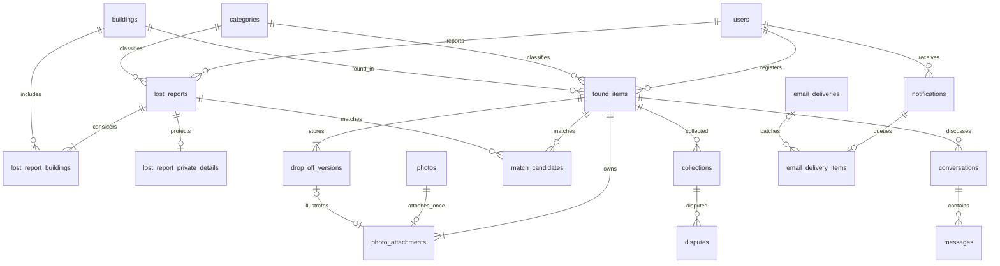

# KAIFind DB 스키마 초안

작성일: 2026-11-02 · 상태: 설계 초안 v0.1 (초기 구현 추가)

SQLAlchemy 모델과 Alembic 초기 마이그레이션 사용법·구현 범위는 [구현 안내](IMPLEMENTATION.md)를 참고한다. 아래는 최초 설계 기록이며 서비스/운영까지 구현 완료를 뜻하지 않는다.

## 설계 근거와 전제

[API 명세](../api/README.md)의 공통 규칙, 인증, 습득물, 분실 신고·매칭, 프로필·알림, 수거·분쟁·메시지, 관리자, SRS 대조 검토를 기준으로 작성했다. 원본 SRS PDF는 현재 저장소에 없으므로 SRS 해석은 내보낸 문서에 근거한다. 실제 Notion 원문을 다시 조회한 결과는 아니다.

초안 작성 당시 코드는 FastAPI 기본 엔드포인트만 있고 DB 모델·마이그레이션은 없었다. 의존성의 SQLAlchemy·Alembic·asyncpg와 맞춰 **PostgreSQL + SQLAlchemy + Alembic**을 제안한다. PostgreSQL 버전·배포 구성은 미확정이다. 이 문서는 논리/물리 설계 초안이며 실행 가능한 전체 DDL이나 적용된 마이그레이션이 아니다.

핵심 결정은 다음과 같다.

- 습득물과 분실 신고를 분리하고 가능한 건물은 연결 테이블로 관리한다.
- 물품 상태, 숨김, 논리 삭제를 서로 독립적으로 관리한다.
- 보관 위치는 변경 불가능한 버전으로 저장하여 현재 위치와 과거 위치를 함께 표현한다.
- 사진은 업로드 자산과 물품 연결 정보를 분리하고, 한 번 연결한 사진의 소속과 보호 등급을 유지한다.
- 수거는 취소 이력을 남기는 별도 테이블로 관리하고 활성 수거는 물품당 하나만 허용한다.
- 후보는 최초 발생 기록을 유지하고 현재 일치 여부를 갱신하여 재등장 알림 중복을 막는다.
- 분실 신고의 비공개 정보는 별도 테이블로 분리하여 종료 트랜잭션에서 삭제한다.
- 상태 변경과 이벤트 예약은 같은 DB 트랜잭션으로 처리하고 외부 이메일은 영속 작업으로 발송한다.

## 표기와 공통 규칙

| 항목 | 초안 |
| --- | --- |
| 이름 | 테이블·컬럼 snake_case, API camelCase는 DTO에서 변환 |
| 식별자 | `uuid`, 앱에서 생성. 아래 `id`는 별도 명시가 없으면 UUID PK |
| 시각 | `timestamptz`, UTC 기준 저장·처리, API 출력·일일 한도·발견일 비교는 Asia/Seoul |
| 날짜 | `date`, 분실 날짜 범위 등 달력 날짜에 사용 |
| 기본값 | `created_at=now()`, `updated_at`은 실제 변경 때 갱신 |
| NULL | 아래 `?`만 nullable. 그 외 필드는 NOT NULL |
| enum | 문자열 + CHECK로 시작. 허용값은 API enum과 동일 |
| FK | 기본 ON DELETE RESTRICT. 예외는 삭제 정책에서 명시 |
| 길이 | API 초안의 제한을 반영. 이름·코드 등 추가 제한은 구현 전 확정 |
| JSON | 감사 허용 metadata·이벤트 ID payload에 한정. 핵심 관계는 FK로 표현 |
| 버전 | 경합 대상의 `version bigint DEFAULT 1`, 변경 시 증가. 잠금 또는 조건부 갱신에 사용 |

회원 탈퇴는 현 API 범위 밖이다. 사용자 FK를 CASCADE로 지우지 않는다. 이메일은 로그인 식별키가 아니며 `mock_subject`로 동일 계정을 식별한다. 비밀번호·전화번호 컬럼은 두지 않는다.

## 주요 관계



등록 완료 시 사진·위치는 최소 한 개다. ERD는 주요 관계만 표시하며, 전체 FK·삭제 규칙은 아래를 따른다.

## 1. 계정·세션·기준정보

| 테이블 | 주요 컬럼 | 제약·설명 |
| --- | --- | --- |
| `users` | id, mock_subject text, name text, email text, affiliation text, role text, language text, created_at, updated_at, version | UNIQUE(mock_subject). affiliation=STUDENT/FACULTY/STAFF, role=MEMBER/ADMIN 기본 MEMBER, language=ko/en 기본 ko |
| `sessions` | id, token_hash text, user_id uuid?, csrf_secret_ciphertext text, created_at, last_activity_at, idle_expires_at, absolute_expires_at | UNIQUE(token_hash), user_id→users. 익명 CSRF 세션은 user_id=NULL. role은 복제하지 않음 |
| `notification_settings` | user_id uuid PK/FK, email_enabled boolean, match_email boolean, collection_email boolean, expiry_email boolean, keyword_email boolean, updated_at | 다섯 값 모두 기본 true. 첫 사용자 생성과 함께 생성 |
| `buildings` | id, code text, name_ko text, name_en text, active boolean, created_at, updated_at | UNIQUE(code), active 기본 true. 비활성화하며 기존 참조 유지 |
| `categories` | id, name_ko text, name_en text, sensitive boolean, active boolean, created_at, updated_at | sensitive는 생성 후 변경 금지, active 기본 true. 이름의 유일성은 현재 요구사항에 없음 |

목업 계정 목록·mockAccountId→mockSubject 매핑은 서버 설정/seed에서 관리한다. 로그인 전 계정마다 users를 미리 생성할 필요는 없다. 최초 로그인 시 UNIQUE(mock_subject)로 생성 경합을 해결하고 이후 로그인은 DB role을 seed 값으로 덮어쓰지 않는다.

세션 쿠키 원문은 저장하지 않고 해시로 조회한다. AUTH-01은 같은 CSRF 토큰을 반환해야 하므로 CSRF는 암호화 저장하여 복호화하는 방식으로 제안한다. 단순 해시만 저장하면 기존 토큰을 반환할 수 없다. 암호화 키는 DB 밖에서 관리한다. 로그인 성공 시 기존 익명/인증 세션 삭제 후 새 세션 생성, 로그아웃은 현재 세션 삭제다. 미활동 30분·절대 12시간은 API 제안값이며 익명 세션에도 유한 만료를 적용한다. Redis로 세션을 이전할 수 있지만 이 초안은 DB를 단일 저장소로 둔다.

## 2. 습득물·보관 위치·사진

### `found_items`

| 컬럼 | 타입 | 설명 |
| --- | --- | --- |
| id | uuid | PK |
| finder_id / category_id / found_building_id | uuid | users / categories / buildings FK |
| title | varchar(100) | 공개 제목, trim 후 비어 있지 않음 |
| description | varchar(2000) | 공개 설명 |
| found_location_description | varchar(300) | 발견 지점. 보관 지점과 구분 |
| found_at | timestamptz | 발견 시각. 미래 금지는 API에서 검사 |
| status | text | POSTED/COLLECTED/EXPIRED, 초기 POSTED |
| hidden | boolean | 기본 false, 신고만으로 자동 변경하지 않음 |
| created_at / updated_at / posted_at / expires_at | timestamptz | 최초 등록·수정·현재 게시 주기 시작·만료 |
| closed_at / deleted_at / purge_after | timestamptz? | 현재 주기 종료·논리 삭제·영구 삭제 예정 |
| version | bigint | 수정/매칭 경합 제어 |

CHECK: POSTED이면 closed_at=NULL, COLLECTED/EXPIRED이면 closed_at NOT NULL. deleted_at은 status와 독립이다. `expires_at=posted_at+30일`은 상태 전환 서비스에서 설정한다. 날짜 경계는 KST로 계산한다.

`sensitive` 응답은 현재 category.sensitive에서 구한다. 사진은 과거 보호 라벨도 별도로 검사하므로 게시물 카테고리 변경으로 보호사진이 공개되지 않는다.

### `drop_off_versions`

| 컬럼 | 타입 | 설명 |
| --- | --- | --- |
| id / item_id | uuid | PK / found_items FK |
| revision_no | integer | 물품별 1부터 증가 |
| mode | text | DROP_OFF/KEPT_BY_FINDER |
| building_id | uuid? | buildings FK |
| spot_description | varchar(300)? | 보관 지점 |
| changed_by_user_id | uuid | users FK |
| changed_at | timestamptz | 최초 등록·변경 시각 |
| sensitive_latched | boolean | 이 위치 버전에 적용된 민감 보호 라벨 |

UNIQUE(item_id, revision_no). DROP_OFF는 building_id·spot_description 필수, KEPT_BY_FINDER는 둘 다 NULL. 최신 revision이 현재 위치다. 위치 변경은 기존 행 수정 없이 새 행을 추가한다. 물품 행 잠금으로 revision 할당을 직렬화한다.

이력 API는 이전 revision을 before, 현재 행을 after로 구성하고 최초 before는 null이다. 사진·updatedAt도 각 버전 기준으로 구성한다. 민감 카테고리로 변경되면 기존 위치 버전의 보호 라벨을 true로 올리고 이후 내리지 않는 보수적 보호 정책을 제안한다. 감사 metadata에는 위치 원문을 복사하지 않는다.

### 사진 테이블

| 테이블 | 주요 컬럼 | 제약·설명 |
| --- | --- | --- |
| `photos` | id, uploader_id uuid FK, purpose text, object_key text, content_type text, size_bytes bigint, width integer, height integer, created_at, unattached_expires_at timestamptz? | purpose=ITEM/DROP_OFF. UNIQUE(object_key). 크기·가로·세로 > 0. GPS 제거 정제본만 저장 |
| `photo_attachments` | photo_id uuid PK/FK, item_id uuid FK, drop_off_version_id uuid? FK, alt_text varchar(200), display_order integer?, sensitive_latched boolean, attached_at, detached_at timestamptz? | photo PK로 자산당 연결 한 번. ITEM은 위치 버전 NULL·순서 필수, DROP_OFF는 위치 버전 필수·순서 NULL |
| `photo_access_grants` | id, token_hash text, photo_id uuid FK, session_id uuid FK, expires_at, created_at | UNIQUE(token_hash). 불투명 URL 토큰 원문 미저장. 60초는 제안 |

ITEM의 현재 사진은 detached_at IS NULL, 순서는 물품별 활성 사진에 대해 UNIQUE(item_id, display_order). DROP_OFF는 UNIQUE(drop_off_version_id)로 버전당 최대 한 장이다. FK `(drop_off_version_id,item_id)`가 같은 물품의 위치 버전만 가리키도록 복합 UNIQUE/FK를 둔다. 목적 일치·업로더 소유권은 연결 트랜잭션에서 photos 행을 잠그고 확인한다. 사진 1~5장·최소 한 장은 테이블 간 조건이므로 서비스에서 최종 집합을 검사한다.

사진 교체는 이전 ITEM 연결의 detached_at만 설정한다. 소속을 지우거나 다른 물품에 재연결하지 않는다. 이전 보관 사진은 위치 이력에서 계속 참조한다. 연결된 사진은 미연결 만료 대상에서 제외하며 물품 보존 주기를 따른다. 제거된 ITEM 사진은 일반 사진 API 접근을 차단하는 정책을 제안한다.

`sensitive_latched`는 false→true만 가능하다. 연결 시 현재 민감 여부를 반영하고 민감 카테고리로 변경하면 기존 연결 전부 true로 올린다. 실제 보호 여부는 `현재 category.sensitive OR sensitive_latched OR purpose=DROP_OFF`다. 민감 열람 감사 대상은 현재 민감 또는 민감 라벨인 사진이며 보관사진은 항상 회원 전용이다.

URL 만료뿐 아니라 실제 바이트 제공 때 세션·현재 역할·hidden/deleted·연결 상태를 다시 검사한다. 미연결 사진은 업로더만 접근한다. 토큰을 가진 것만으로 접근을 허용하지 않는다. 민감 열람 로그 커밋 실패 시 바이트를 전달하지 않는다.

## 3. 분실 신고·매칭

| 테이블 | 주요 컬럼 | 제약·설명 |
| --- | --- | --- |
| `lost_reports` | id, owner_id uuid FK, category_id uuid FK, description varchar(2000), lost_date_from date, lost_date_to date, status text, created_at, updated_at, expires_at, closed_at timestamptz?, purge_after timestamptz?, version bigint | OPEN/RESOLVED/CLOSED. CHECK(from<=to). 미래 날짜는 API 검사. OPEN이면 closed_at NULL, 종료면 NOT NULL |
| `lost_report_buildings` | report_id uuid FK, building_id uuid FK | 복합 PK(report_id,building_id). 신고당 1~100개는 트랜잭션에서 검사 |
| `lost_report_private_details` | report_id uuid PK/FK, details varchar(1000) | OPEN 상세에서만 본인/관리자 조회. 신고 종료 트랜잭션에서 행 DELETE |
| `match_candidates` | id, report_id uuid FK, item_id uuid FK, matched_at, last_evaluated_at, active boolean, building_matched boolean, keyword_matched boolean, first_notified_at timestamptz? | UNIQUE(report_id,item_id). 최초 matched_at 불변. active이면 두 일치 사유 중 하나 이상 true |

후보가 조건을 잃으면 active=false로 바꾸고 현재 후보 목록·FR-22 대상에서 제외한다. 다시 일치하면 같은 행을 활성화하며 최초 알림 기록을 유지한다. 이는 API의 ‘현재 연결 제거 + 최초 발생 이력 유지’를 한 테이블로 구현하는 제안이다. active=false도 연결된 어느 한쪽 삭제 시 제거한다. 종료 신고는 기존 active 후보를 조회할 수 있으나 신규 알림을 만들지 않는다.

매칭 조건은 다음과 같으며 상태·숨김은 후보 판정 조건과 분리한다.

```text
item.category_id = report.category_id
AND DATE(item.found_at AT TIME ZONE 'Asia/Seoul') >= report.lost_date_from
AND (발견 건물이 가능한 건물에 포함 OR 공개 제목/설명에 공통 키워드)
```

lost_date_to를 발견일 상한으로 사용하지 않는다. 공통 키워드는 신고 description과 물품 title/description의 정규화 토큰을 비교하고 private details는 제외한다. 별도 검색 서버는 초기에는 도입하지 않는다.

초안에서는 생성·수정·수거 시 대상 행을 잠그고 현재 데이터를 기준으로 후보를 동기 재평가한다. 수거 시 해당 물품의 최신 조건으로 후보를 보정한 후 수거자의 OPEN 신고를 모두 종료한다. 물품→신고 UUID 순서로 잠그는 공통 규약을 적용하고 교착/직렬화 실패는 전체 트랜잭션 재시도한다. 신고 수정도 영향 물품과 신고를 같은 순서로 잠그며 대상 집합이 바뀌면 재검사한다. 비동기 매칭으로 변경할 경우 버전 검증과 FR-22의 최신 후보 보장 방식을 먼저 설계해야 한다.

신고 종료 시 private details를 삭제하고 closed_at은 최초 종료 시각으로 고정한다. CLOSED→RESOLVED도 이 시각·purge_after를 연장하지 않는다. OPEN 등록에는 비공개 행 필수, 종료에는 행 없음이라는 교차 테이블 불변식은 서비스와 구현 단계의 지연 제약 트리거로 보장한다.

## 4. 수거·분쟁·게시물 신고

| 테이블 | 주요 컬럼 | 제약·설명 |
| --- | --- | --- |
| `collections` | id, item_id uuid (논리 참조), finder_id uuid FK, collector_id uuid FK, collected_at, undone_at timestamptz?, undone_by_user_id uuid? FK, purge_after | finder_id는 당시 작성자 ID. 취소 시 기록 삭제 대신 undone_at·행위자 저장 |
| `disputes` | id, collection_id uuid FK, reason varchar(1000), status text, decision text?, created_at, resolved_at timestamptz?, reviewer_id uuid? FK, purge_after | OPEN/RESOLVED, UPHELD/DISMISSED. 물품·수거자·작성자는 collection에서 조회 |
| `collection_restrictions` | user_id uuid PK/FK, restricted boolean, source_dispute_id uuid? FK, updated_by_user_id uuid FK, updated_at | 행 없음은 제한 없음. source_dispute_id는 아래 보존 충돌 참고 |
| `post_reports` | id, item_id uuid FK, reporter_id uuid FK, reason_code text, details varchar(1000), status text, decision text?, created_at, reviewed_at timestamptz?, reviewer_id uuid? FK | reason=INAPPROPRIATE/SPAM/OTHER, OPEN/REVIEWED, HIDE/DISMISS |

활성 수거 유일성과 운영 중복 제약은 아래와 같다. SQL은 핵심 제약 예시이며 전체 DDL은 아니다.

```sql
CREATE UNIQUE INDEX uq_collections_active_item
    ON collections (item_id) WHERE undone_at IS NULL;
CREATE UNIQUE INDEX uq_disputes_open_collection
    ON disputes (collection_id) WHERE status = 'OPEN';
CREATE UNIQUE INDEX uq_post_reports_open_reporter
    ON post_reports (item_id, reporter_id) WHERE status = 'OPEN';
```

수거 취소 필드는 둘 다 NULL 또는 둘 다 NOT NULL이다. 분쟁/신고는 OPEN이면 결과·검토자·검토시각 모두 NULL, 처리 완료이면 모두 NOT NULL이다. 인용된 분쟁의 실제 collector_id와 제한 대상 user_id가 같은지 관리자 트랜잭션에서 검사한다.

수거 기록의 보존 만료 후 활성 행이 사라져도 COLLECTED 상태는 유지한다. 이때 현재 수거 기록 조회/취소의 처리 정책은 아래 미정 항목에 남긴다. item_id FK는 보존 기한이 서로 다르므로 물품 영구 삭제 전 최소 수거 기록에 필요한 ID를 유지하는 방식으로 분리해야 한다. 초안은 collections.item_id를 **FK 없는 원래 물품 UUID**로 두는 예외를 제안한다. 이 컬럼에는 물리 FK를 생성하지 않는다. finder_id·collector_id FK와 분쟁→수거 FK는 유지한다. 새로운 수거 생성 시 물품 존재·작성자 일치는 잠금 트랜잭션에서 검사한다.

## 5. 대화·메시지

| 테이블 | 주요 컬럼 | 제약·설명 |
| --- | --- | --- |
| `conversations` | id, item_id uuid FK, member_id uuid FK, created_at, updated_at | UNIQUE(item_id,member_id). finder_id는 found_items에서 조회 |
| `messages` | id, conversation_id uuid FK, sender_id uuid FK, content varchar(2000), created_at | 참여자만 발신/열람. 본문 미리보기 별도 저장 없음 |

대화 생성·메시지 전송·수거·만료는 같은 물품 행을 잠근 뒤 상태를 검사한다. 종료 처리에서 conversations를 DELETE하고 messages는 CASCADE로 삭제한다. 종료 커밋 뒤 메시지 삽입이 성공하지 않도록 전송 경로도 반드시 같은 잠금 규약을 따른다. 재등록·취소 후 새 대화는 새 UUID로 생성한다. 관리자는 참여자가 아닌 대화의 메시지를 읽을 수 없다.

member_id≠finder_id와 sender가 두 참여자 중 한 명이라는 조건은 교차 테이블 검사다. 서비스에서 검사하며 연락처 검출도 API 처리 단계에 둔다. 본문은 감사·outbox·일반 로그에 복사하지 않는다.

## 6. 알림·구독·외부 작업

| 테이블 | 주요 컬럼 | 제약·설명 |
| --- | --- | --- |
| `keyword_subscriptions` | id, user_id uuid FK, keyword varchar(50), normalized_keyword text, created_at | UNIQUE(user_id,normalized_keyword). trim·Unicode 정규화·영문 소문자 적용 |
| `outbox_events` | id, event_type text, aggregate_id uuid, aggregate_version bigint, payload jsonb, created_at, processed_at timestamptz?, attempts integer, next_attempt_at, lease_until timestamptz?, last_error_code text? | UNIQUE(aggregate_id,aggregate_version,event_type). payload는 관련 UUID·버전만 |
| `notifications` | id, event_id uuid, recipient_id uuid FK, type text, item_id uuid? FK, report_id uuid? FK, created_at, read_at timestamptz?, purge_after | UNIQUE(event_id,recipient_id,type). MATCH_CANDIDATE/ITEM_COLLECTED/ITEM_EXPIRED/KEYWORD_MATCH |
| `notification_keyword_sources` | notification_id uuid FK, subscription_id uuid FK | 복합 PK. 여러 구독 중 살아 있는 일치 근거 확인 |
| `email_delivery_items` | id, notification_id uuid FK, delivery_id uuid? FK, status text, digest_on date?, created_at | UNIQUE(notification_id). PENDING/QUEUED/SENT/CANCELLED. 요약 마감 뒤 이월 날짜 기록 |
| `email_deliveries` | id, recipient_id uuid FK, delivery_date date, kind text, slot_no integer, status text, attempts integer, next_attempt_at, lease_until timestamptz?, provider_message_id text?, last_error_code text?, created_at, sent_at timestamptz? | kind=INDIVIDUAL/DIGEST, status=PENDING/SENDING/SENT/RETRY/FAILED/CANCELLED |

`notifications.event_id`는 논리 이벤트 UUID이며 outbox 정리 후에도 남도록 물리 FK를 두지 않는다. 후보 최초 알림 생성은 후보 행 잠금 후 notifications insert와 first_notified_at 갱신을 함께 커밋한다. 동일 쌍 재등장 시 새 이벤트로 재통지하지 않는다. 키워드 알림은 물품 등록 이벤트·수신자·종류로 중복을 막고 여러 구독 근거만 연결한다.

message와 targetPath는 type·관련 ID로 생성한다. 번역 문구·사진·위치·private details·수신 이메일을 payload에 복제하지 않는다. outbox 처리기는 인앱 알림과 이메일 항목 생성을 한 트랜잭션으로 수행하고 processed_at을 기록한다. 재시도 때 UNIQUE 제약으로 중복을 막는다.

한도 제안은 UNIQUE(recipient_id,delivery_date,slot_no), INDIVIDUAL=1~19, DIGEST=20으로 표현한다. 수신자 행 잠금 후 KST 발송일 슬롯을 예약하고 DIGEST는 회원·날짜당 하나만 만든다. 재시도는 같은 delivery ID·슬롯을 사용한다. 날짜가 바뀌어 실제 전송하는 재시도는 **실제 전송일의 슬롯으로 원자적 재예약**하여 당일 한도를 넘기지 않는다. 슬롯이 없으면 요약/다음 날로 이월한다. 이미 전송 결과가 불명확한 건은 재발송 전 제공자의 논리 메일 ID로 확인한다. 외부 제공자 idempotency가 없으면 정확히 한 번 전송은 DB만으로 보장할 수 없다.

발송 직전에 현재 수신 설정, 신고 OPEN 여부, 물품 접근 가능성, 남아 있는 구독 근거를 재확인한다. 구독 삭제는 source 연결을 CASCADE로 지우고 유효 근거가 하나라도 남으면 발송할 수 있다. 발송 워커와 종료 작업의 경계에 이미 외부 요청 중인 메일은 회수할 수 없으므로 그 경계·재검사 시점을 구현에서 명시한다.

영구 실패는 FAILED로 남겨 운영자가 확인하게 하며 성공으로 처리하지 않는다. 전달 작업 claim은 lease와 행 잠금으로 중복 워커 실행을 제어한다. 한 요약의 email_delivery_items를 통해 재시도·중복 편입을 막는다.

## 7. 감사·보존·삭제

### `audit_logs`

`id uuid PK`, `actor_id uuid?`, `actor_type text`, `action text`, `target_type text`, `target_id uuid`, `metadata jsonb`, `occurred_at timestamptz`, `purge_after timestamptz`.

actor_type=MEMBER/ADMIN/SYSTEM. SYSTEM만 actor_id=NULL이며 당시 역할을 보존한다. actor_id·target_id는 보존 기간이 독립적이므로 물리 FK를 두지 않는 최소 식별자다. action·target_type·metadata 키/값은 [관리자 감사 계약](../api/06-admin.md)의 허용목록으로 제한한다. 필수 상태·수거·위치변경·민감 열람 이벤트 및 LOST_REPORT_STATUS_CHANGED를 포함한다. 일반 앱 계정에는 UPDATE/DELETE 권한을 주지 않고 보존 작업 계정만 삭제한다.

변경 감사는 변경과 같은 트랜잭션, 민감 조회 감사는 데이터 전달 전에 커밋한다. URL 발급 감사는 실제 사진 열람 감사를 대체하지 않는다. 위치 원문·메시지·연락처·사진 URL을 metadata에 넣지 않는다.

### 삭제 의존성과 시점

| 대상 | 시점 | 삭제·유지 방식 |
| --- | --- | --- |
| 분실 비공개 정보 | RESOLVED/CLOSED 전환 즉시 | private 행 물리 삭제, 목록·큐·로그 복제 금지 |
| 대화·메시지 | 물품 COLLECTED/EXPIRED 또는 논리 삭제 즉시 | conversation 삭제→messages CASCADE, 캐시도 차단/삭제 |
| 후보 | 조건 불일치 | active=false, 최초 통지 이력 유지 |
| 후보 | 물품 논리 삭제 또는 양쪽 중 하나 영구 삭제 | 행 삭제. 영구 삭제 FK는 양쪽 CASCADE |
| 물품·사진·위치 이력 | 종료 후 1년 | purge_after 도달 시 전체 삭제. 사진 객체 삭제 작업도 예약 |
| 미종료 물품 논리 삭제 | 삭제 후 1년, 제안 | deleted_at+1년. 기존 종료 물품은 기존 기한 연장 없음 |
| 분실 신고 일반 정보 | 최초 closed_at+1년, 제안 | buildings/private/candidates 연결 CASCADE |
| 수거·분쟁 | collected_at+1년, 분쟁은 같은 기한 제안 | 수거→분쟁 CASCADE. 취소·검토로 연장하지 않음 |
| 게시물 신고 | 물품 영구 삭제 시, 제안 | item→post_reports CASCADE |
| 감사 | occurred_at+1년 | 원본 물품 삭제와 독립적으로 보존 |
| 알림·메일 항목 | 생성 후 최대 1년 또는 대상 영구 삭제, 제안 | item/report→notifications CASCADE→email_delivery_items CASCADE |
| 세션·사진 URL grant | 만료/폐기 | session→grant CASCADE. 요청 시 만료 검사 후 주기적 청소 |
| 미연결 사진 | 업로드 24시간 후, 제안 | 객체와 DB 정리. 연결 경합은 사진 행 잠금으로 처리 |

물품 영구 삭제 시 drop_off_versions·photo_attachments는 CASCADE로 제거한다. photos는 연결 삭제 전에 object_key를 객체 삭제 outbox에 예약하고 자산 행도 삭제한다. 스토리지 실패는 재시도하며 outbox는 삭제할 객체 키만 제한적으로 보유하고 삭제 성공 후 정리한다. 일반 이벤트의 UUID-only payload에 대한 명시적 예외다. 스토리지 버전·썸네일도 함께 삭제해야 한다.

물품 재등록·수거 취소는 closed_at과 purge_after를 NULL로 하고 새 게시 주기를 시작하는 제안이다. 이전 수거·감사 기록의 독립 보존 만료는 바꾸지 않는다. 한 주기 안에서 논리 삭제·일반 수정으로 purge_after를 늦추지 않는다.

outbox는 완료 후 단기 보존(예: 7일), 미완료 작업은 대상 삭제 시 취소하고 민감 payload를 남기지 않는다. email_deliveries는 관련 항목이 없어지면 취소/정리하되 재시도 중 중복 전송을 막는 최소 논리 메일 ID의 보존 기간은 제공자 정책과 함께 확정한다. 백업 보존·복원 후 삭제 재적용 절차는 별도 운영 설계가 필요하다.

## 8. 주요 인덱스 초안

PK·UNIQUE 인덱스 외 아래를 우선 검토한다. 모든 필터 조합에 복합 인덱스를 만들지 않고 실제 데이터·쿼리 계획으로 조정한다.

| 대상 | 인덱스 | 용도 |
| --- | --- | --- |
| found_items | (status,created_at DESC,id DESC) WHERE NOT hidden AND deleted_at IS NULL | 기본 검색·종료 상태 검색 |
| found_items | (category_id,found_building_id,found_at) WHERE deleted_at IS NULL | 필터·후보 계산 |
| found_items | (finder_id,created_at DESC,id DESC) WHERE deleted_at IS NULL | 내 게시물 |
| found_items | (expires_at,id) WHERE status='POSTED' AND deleted_at IS NULL | 만료 배치 |
| found_items | (purge_after) WHERE purge_after IS NOT NULL | 보존 정리 |
| drop_off_versions | (item_id,revision_no DESC), (building_id,item_id) | 현재/과거 위치·건물 집계 |
| lost_reports | (owner_id,created_at DESC,id DESC), (category_id,lost_date_from) WHERE status='OPEN' | 내 신고·매칭 |
| lost_reports | (expires_at,id) WHERE status='OPEN' | 자동 종료 |
| lost_report_buildings | (building_id,report_id) | 건물 역방향 후보 |
| match_candidates | (report_id,matched_at DESC,id DESC) WHERE active, (item_id,report_id) WHERE active | 후보 목록·수거 연동 |
| conversations | (member_id,updated_at DESC,id DESC), (item_id,updated_at DESC,id DESC) | 참여자 대화 목록 |
| messages | (conversation_id,created_at,id) | 메시지 시간순 |
| notifications | (recipient_id,created_at DESC,id DESC), 동일 컬럼 WHERE read_at IS NULL | 알림·미확인 |
| outbox_events / email_deliveries | (next_attempt_at,id) WHERE 처리 대기 상태 | 작업 claim·재시도 |
| disputes / post_reports | (status,created_at DESC,id DESC) | 관리자 처리 대기 |
| audit_logs | (occurred_at DESC,id DESC), (target_id,occurred_at DESC), (actor_id,occurred_at DESC) | 감사 조회 |
| sessions / photo_access_grants | (idle_expires_at) / (expires_at) | 만료 정리 |

검색 q의 일치 의미는 API에 구체적으로 확정되지 않았다. 초기 제안은 정규화된 공개 title/description의 부분 문자열 검색이며 pg_trgm GIN을 후보로 검토한다. 한국어 처리·짧은 검색어·확장 설치 가능성을 실제 DB에서 확인한 뒤 결정한다. 매칭의 ‘공통 토큰’ 규칙과 구독의 ‘substring’ 규칙은 각각 따로 유지한다. 비공개 정보·보관 위치는 검색 인덱스에 넣지 않는다.

KST 날짜 필터는 found_at에 날짜 함수를 씌우기보다 KST 시작/종료를 UTC 범위로 변환한다. 건물 집계는 최신 drop_off_versions와 공개 POSTED 물품만 조인한다. 관리자 상태 통계는 deleted_at IS NULL만 적용하고 hidden은 포함한다. 별도 영구 누적 통계 테이블은 만들지 않는다.

## 9. 주요 트랜잭션 경계

| 작업 | 한 트랜잭션에서 처리할 내용 |
| --- | --- |
| 습득물 등록 | 물품·위치 v1·사진 연결·후보 계산/최초 통지 예약·감사·신규 물품 이벤트 |
| 습득물 수정 | 소유권·버전 검사, 사진/카테고리 보호 라벨, 본문 수정, 후보 재평가·통지 예약 |
| 위치 변경 | 물품 잠금, 버전 추가·사진 연결, 위치 변경 감사 |
| 수거 | 사용자 제한 상태 잠금·검사, 물품 POSTED 확인·잠금, 최신 후보 보정, 활성 수거 생성, COLLECTED 전환, 수거자 관련 OPEN 신고 전부 종료·private 삭제, 대화 삭제, 감사·알림 이벤트 |
| 수거 취소 | 물품·현재 수거 잠금, 취소 기록, POSTED/새 만료 주기, 감사. 신고·메시지 복원 없음 |
| 물품 만료 | POSTED·기한 재검사, EXPIRED·closed_at·purge_after, 대화 삭제, 감사·만료 알림 이벤트 |
| 신고 종료·연장 | 신고 잠금·기한/상태 검사, 최초 종료 또는 연장, 종료 시 private 삭제·대기 메일 제외, 감사 |
| 분쟁 검토 | OPEN 검사, 결과 저장, 필요 시 수거자 제한 변경, 감사. 수거 취소는 별도 작업 |
| 게시물 신고 검토 | OPEN 검사, REVIEWED, HIDE면 hidden 변경, 감사 |
| 역할 변경 | 현재 권한 검사, 관리자 회수 직렬화로 마지막 관리자 보호, role 변경·감사 |

잠금 순서는 서비스 전반에서 통일하고 DB 경합 오류를 API 409 또는 안전한 전체 재시도로 변환한다. 사용자 제한 갱신과 수거는 동일 users 행을 잠가 ‘제한 직후 수거 성공’ 경합을 제어한다. 별도 행이 없는 collection_restrictions만 잠그는 방식은 사용하지 않는다.

## 10. 설계 확정 전에 논의할 사항

| 사항 | 초안/결정 필요 내용 |
| --- | --- |
| DB와 저장소 | PostgreSQL 버전·운영 위치, 객체 저장소 선택. 라이브러리 설치 사실만으로 확정하지 않음 |
| 보존 주기 | 재등록 시 물품의 이전 위치/사진도 새 주기로 함께 보존할지. 초안은 물품 단위, 과거 버전별 만료는 미도입 |
| 장기 수거 상태 | collected_at+1년 후 기록은 삭제되지만 재등록된 물품은 남을 수 있음. 이때 COLLECTED 기록 조회·취소를 허용할지 정책 필요 |
| 제한 근거와 삭제 충돌 | 제한은 명시적 해제까지 유지하지만 근거 분쟁은 1년 뒤 삭제됨. source_dispute_id를 FK ON DELETE SET NULL로 두고 제한 유지 제안. 근거 삭제 뒤 ADS-04가 인용 분쟁 ID를 필수로 요구하는 계약은 조정 필요. 분쟁 영구 보존으로 우회하지 않음 |
| 한도·요약 | 20통·20시·마감 이후 이월·재시도 실제 발송일 재예약은 제안이며 확정 필요 |
| 세션·URL | 30분/12시간·사진 60초·미연결 24시간은 API 제안값 |
| 키워드·검색 | 정규화 방식, 한국어 토큰화, 검색 q의 일치 의미, DB 확장 허용 여부 |
| 보안·암호화 | DB/스토리지 암호화, CSRF 암호화 키 관리, 백업 보존·복원 후 삭제 재적용 |
| 구현 범위 | Could 키워드·Should 기능 구현 순서. 직접 보관을 유지하면 메시지 연락 경로도 유지 |

수거자의 자기 게시물 수거 금지는 현재 API에 명시되어 있지 않아 임의 CHECK를 추가하지 않았다. 마지막 관리자 보호·OPEN 신고 중복 제한·불일치 후보 비활성화 역시 기존 SRS 확정 규칙과 구분되는 설계 제안이다.

## 11. 구현 시 검증할 불변식

- 동시 수거·만료 중 한 상태 전환만 성공하고 활성 수거자는 한 명이다.
- 수거자의 연결된 OPEN 신고가 모두 종료되며 다른 회원 신고는 유지된다.
- 종료 커밋 직후 private details·대화·메시지가 활성 DB에 없고 경합 중 전송으로 다시 생성되지 않는다.
- 불일치→재일치·이벤트 재처리에도 후보 최초 알림과 키워드 알림이 중복되지 않는다.
- 카테고리 하향·사진 교체·과거 위치 조회·기발급 URL로 보호 라벨을 우회할 수 없다.
- 세션·사용자 역할·hidden/deleted를 실제 조회 시 재검사하고 민감 감사 실패 시 데이터를 내보내지 않는다.
- 두 워커의 발송 슬롯 경합·요약 편입·날짜를 넘긴 재시도가 일일 한도를 우회하지 않는다.
- 영구 삭제가 독립 보존 중인 수거·감사를 조기 삭제하거나 기간을 연장하지 않는다.

이번 작업은 문서 초안 작성과 로컬 API 요구사항 대조까지다. DB 실행·마이그레이션·동시성·성능·복구 테스트는 아직 수행하지 않았다.
