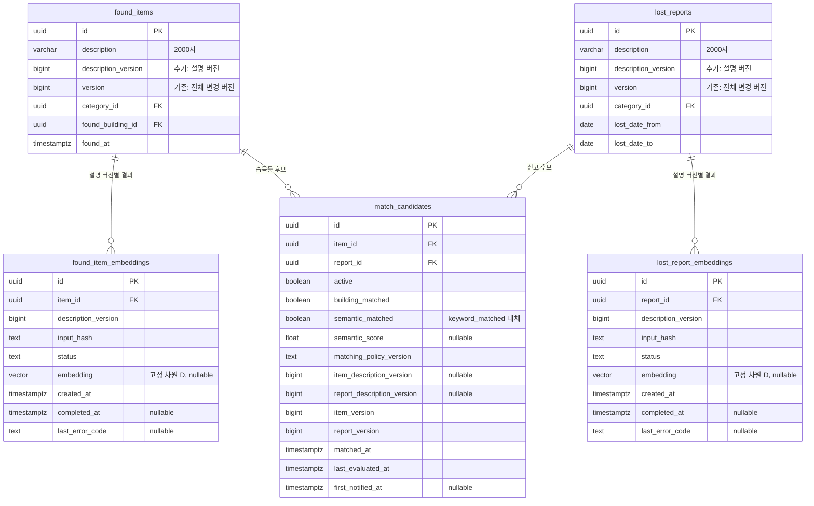
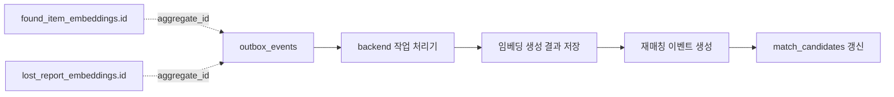

# 임베딩 저장·매칭 DB 구조

- 작성일: 2026-11-06 (KST)
- 상태: 설명 버전·후보 판정 메타데이터·Outbox 토큰은 revision `20261106_0005`로 구현. 벡터 테이블은 모델 차원 확정 후 구현한다.
- 전제: 사전 실험으로 선정한 단일 모델·리비전·입력 규칙·출력 차원 D를 고정한다.
- 관련 계획: [다국어 임베딩 매칭 설계·구현 계획](multilingual-embedding-matching.md)

## 현재 구현 범위

모델 선정 전에는 벡터 테이블을 제외한 구조부터 구현한다. 아래 ERD는 최종 목표 구조이며 found_item_embeddings와 lost_report_embeddings는 아직 DB에 생성하지 않는다.

- description_version은 DB 트리거가 설명 변경 시 1 증가시킨다. 설명이 같으면 유지하고, 임의의 버전 갱신은 무시한다. 서비스는 이를 중복 증가시키지 않으며 갱신 후 값을 다시 읽어 작업을 생성해야 한다.
- 후보의 정책·판정 버전은 기존 미평가 행을 위해 NULL을 허용한다. 의미 점수 범위와 의미 일치 근거, 양수 버전은 CHECK로 검사한다.
- keyword_matched는 전환용으로 보존한다. 키워드만 일치한 기존 후보는 비활성화하며 최초 시각·알림 기록은 보존한다. 다운그레이드 시 이전 활성 상태를 자동 복구하지 않는다.
- Outbox에 nullable lease_token을 추가한다. 작업 처리기에서의 토큰 검증은 후속 구현이다.

## 관계도

기존 테이블은 매칭에 필요한 컬럼만 표시했다. `vector`의 실제 DDL 타입은 `vector(D)`다. 설명 버전별로 임베딩 행을 생성하므로 원본 하나에 여러 임베딩 행이 연결된다.



임베딩 행과 후보 사이에는 필수 FK를 두지 않는 안을 사용한다. 후보는 정책·설명 버전·원본 버전을 기록하므로 이전 임베딩 행을 정리해도 최초 후보 이력을 보존할 수 있다. 다만 이 정보만으로 삭제된 과거 벡터를 복원하거나 점수를 재계산할 수는 없다.

## 테이블별 책임

| 영역 | 변경 | 책임 |
| --- | --- | --- |
| found_items / lost_reports | description_version 추가 | 원본 설명과 현재 설명 버전 관리 |
| found_item_embeddings | 신규 | 습득물 설명 버전별 생성 상태·벡터 |
| lost_report_embeddings | 신규 | 신고 설명 버전별 생성 상태·벡터 |
| match_candidates | 의미 판정 컬럼·버전 추가 | 두 원본의 후보 관계와 마지막 판정 근거 |
| outbox_events | 작업 확보 토큰 추가 검토 | 작업 실행·재시도·임대·오류 이력 |

embedding_profiles와 모델별 파티션은 만들지 않는다. 모델·리비전·D·전처리·양쪽 입력 형식·정규화 규칙은 버전 관리되는 고정 설정에 기록한다. 임계치와 판정식도 matching_policy_version으로 조회 가능한 불변 설정에 기록한다. 별도 matching_policies 테이블은 이 안에서 필수가 아니다.

## 키와 제약조건

### 원본

- description_version은 bigint NOT NULL DEFAULT 1, CHECK(description_version > 0).
- description 변경 시에만 증가시킨다. 카테고리·건물·날짜 변경은 기존 version으로 추적한다.
- 원본·설명 버전·새 PENDING 행·Outbox 이벤트는 같은 트랜잭션에 저장한다.

### 임베딩

| 조건 | found_item_embeddings | lost_report_embeddings |
| --- | --- | --- |
| PK | id | id |
| 원본 FK | item_id → found_items.id | report_id → lost_reports.id |
| 유일 키 | (item_id, description_version) | (report_id, description_version) |
| 영구 삭제 | ON DELETE CASCADE | ON DELETE CASCADE |

- id·원본 FK·description_version·input_hash·status·created_at은 NOT NULL.
- status는 PENDING / PROCESSING / READY / FAILED만 허용한다.
- READY일 때 embedding과 completed_at은 NOT NULL, 나머지 상태에서는 둘 다 NULL이다.
- embedding은 고정 차원 vector(D)이며 0 벡터는 저장 전에 거부한다.
- input_hash는 실제 모델 입력의 SHA-256이다. UNIQUE를 두지 않는다. 서로 다른 물품이 같은 설명을 사용할 수 있다.
- 동일 원본·설명 버전의 재시도는 기존 행을 사용한다.
- 이전 설명 버전의 READY 행이 남아 있어도 현재 검색에서 제외한다. 과거 행의 정리 기간은 별도 확정한다.
- 원본의 최신 description_version과 일치하는지는 CHECK나 일반 FK가 아닌 조회 조건·서비스 트랜잭션으로 보장한다. 과거 버전 행도 보존할 수 있으므로 최신 버전에 대한 FK를 두지 않는다.

### 후보

- 기존 UNIQUE(report_id, item_id)와 원본 FK의 ON DELETE CASCADE를 유지한다.
- semantic_score는 double precision, 미계산은 NULL이다. item/report_description_version도 의미 판정 미수행 시 NULL일 수 있다.
- semantic_matched=true이면 점수와 양쪽 설명 버전이 있어야 한다. 유사도를 계산했다면 불일치여도 점수와 버전을 기록한다.
- item_version·report_version은 마지막 판정 시점의 전체 원본 버전이다.
- 건물 OR 정책을 선택하면 CHECK(NOT active OR building_matched OR semantic_matched)를 적용한다. 의미 일치 필수 정책을 선택하면 제약도 그에 맞게 바꾼다. 후보 조건은 상위 계획의 미정 사항이다.
- 최초 matched_at과 first_notified_at은 재평가·재활성화 시 초기화하지 않는다.
- 기존 keyword_matched=true를 semantic_matched=true로 복사하지 않고 재평가한다.

## Outbox와의 연결

Outbox는 범용 이벤트 테이블이므로 임베딩 행과의 연결은 논리 참조다. 아래 점선 화살표는 실제 FK를 의미하지 않는다.



| Outbox 필드 | 사용 방식 |
| --- | --- |
| event_type | 습득물/신고 임베딩 생성 이벤트를 구분 |
| aggregate_id | 임베딩 행 id |
| aggregate_version | 생성 이벤트는 1 |
| payload | 원본 ID·설명 버전 등 최소 식별자. 원문·비공개 정보 제외 |
| attempts / next_attempt_at | 재시도 제어 |
| lease_until | 작업 임대 만료 |
| lease_token | 추가 제안. 만료된 이전 처리기의 결과 반영 차단 |
| last_error_code | 실행 실패 원인 코드 |
| processed_at | 처리 완료 시각 |

재시도 횟수와 임대는 Outbox가 관리한다. 임베딩 테이블의 last_error_code는 사용자/운영자가 현재 결과 상태를 확인하기 위한 요약이며, 실패·성공 상태 변경 시 같은 트랜잭션에서 갱신하거나 비운다. 원본 삭제 후 남은 논리 참조 이벤트는 처리기가 대상 부재를 확인하고 완료 처리한다.

## 현재 벡터 선택과 동시성

```text
임베딩.status = READY
AND 임베딩.description_version = 원본.description_version
```

원본 상태·노출·카테고리·날짜 등 후보 조건은 이 조건과 별도로 적용한다. description_version이 오래된 결과는 모델 호출에 성공했어도 현재 결과로 반영하지 않는다.

1. 작업 처리기는 대상 설명 버전과 작업 확보 토큰을 확인한다.
2. DB 잠금 없이 모델을 호출한다.
3. 저장 트랜잭션에서 원본 버전·확보 토큰을 다시 확인한다.
4. 유효한 경우 READY 저장과 재매칭 이벤트 생성을 함께 커밋한다.
5. 후보 저장 시에도 양쪽 원본 version을 재확인하여 오래된 판정을 차단한다.

임베딩 READY는 벡터 생성 완료만 뜻한다. API의 matchingStatus=READY는 해당 버전·정책의 후보 갱신 완료까지 뜻하므로, 재평가 진행 기록은 별도로 설계한다. 이 도식의 임베딩 status만으로 전체 매칭 완료를 판단하지 않는다.

## 인덱스와 구현 전 확인 사항

- 임베딩 유일 키 인덱스로 원본·현재 설명 버전을 조회한다.
- 기존 후보 목록·원본 연결 인덱스를 유지한다.
- 초기에는 조건으로 대상을 좁힌 뒤 정확 유사도 비교를 사용한다. 벡터 인덱스는 실제 D·규모·실행 계획을 확인한 뒤 결정한다.
- 모델명·리비전·D와 초기 임계치는 사전 실험 결과를 전달받아 확정해야 한다.
- 과거 임베딩 보존 기간, 후보 조건, 수거 시 비동기 미완료 처리, 재평가 진행 기록은 미정이다.
- 벡터 생성·후보 갱신 서비스, 매칭 진행 기록과 벡터 테이블은 후속 구현이다. 현재 범위는 위의 구현 범위를 따른다.
