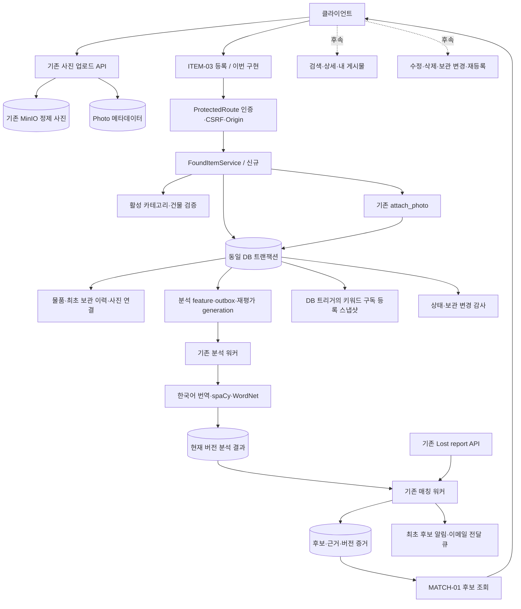
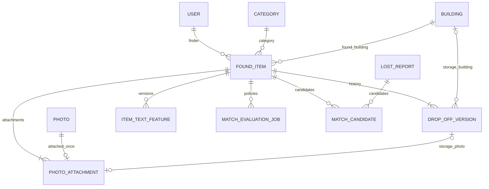
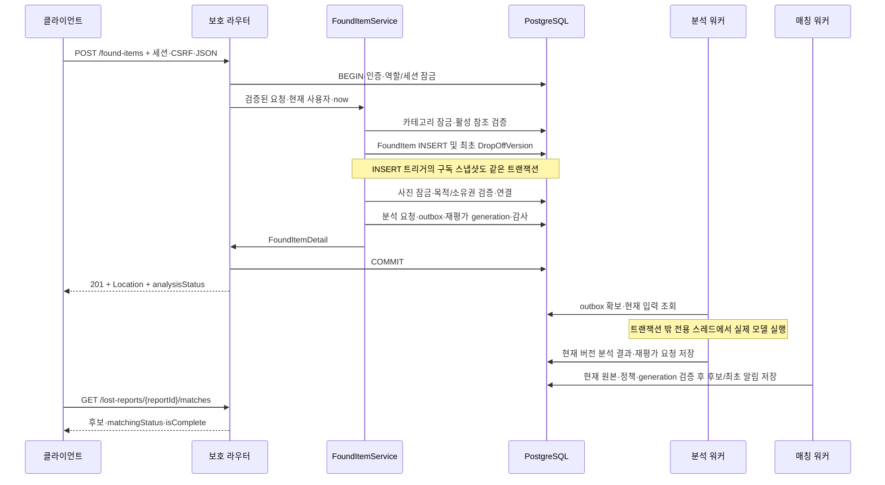

# Found item 전체 설계와 등록 우선 구현 계획

작성일: 2026-11-13 KST. 전체 로드맵과 ITEM-03 등록 구현을 기록한다. 나머지 ITEM API는 후속 범위다.

## 1. 목표와 이번 범위

전체 ITEM-01~10의 책임과 확장 구조를 정리하되, 이번 구현은 **ITEM-03 POST /api/v1/found-items만** 대상으로 한다.
기존 lost report API와 조합하여 사진 업로드 → 습득물 등록 → 실제 한국어 분석 → 후보 생성 → 후보 조회를 검증한다.
조회·수정·삭제·보관 위치 조회/변경·재등록 API는 이번 구현 범위에 포함하지 않는다.
등록 응답은 FoundItemDetail을 완전하게 반환하고 등록에 필요한 사진·최초 보관 이력은 생략하지 않는다.
Location 헤더가 가리키는 ITEM-02는 후속 구현까지 501일 수 있다. 등록 응답과 MATCH-01로 이번 결과를 확인한다.

검토 기준:

- [API 목차](../api/README.md), [공통 규칙](../api/00-common.md)
- [습득물·검색·사진](../api/02-found-items.md), [분실 신고·매칭](../api/03-lost-reports-matching.md)
- [수거·분쟁·메시지](../api/05-collection-disputes-messages.md), [관리자](../api/06-admin.md)
- [원본 API 연결 규약](translation-keyword-implementation-plan.md), [분석 워커](text-analysis-worker.md)
- [매칭](matching-api.md), [분실 신고 구현](lost-reports.md), [일일 만료](daily-expiry.md)

구현 계획을 변경할 때 API 목차와 관련 명세를 다시 확인한다.

## 2. 현재 상태와 재사용 대상

| 영역 | 현재 상태 | 연결 방향 |
| --- | --- | --- |
| ITEM-03 | 등록 구현 | 보호 라우터·사진·보관 이력·분석 요청 연결 |
| 나머지 ITEM | router/found_items.py의 501 골격 | 후속 로드맵 유지 |
| MOD-01 게시물 신고 | 같은 라우터에서 구현됨 | 기존 라우트·권한 유지 |
| PHOTO-01~03 | 업로드·접근 URL·바이트 구현 | 사진 업로드 및 보호 경로 재사용 |
| 사진 연결 | service/photo_attachments.py의 attach_photo | 소유자·purpose·만료·재사용·보호 라벨 검사 재사용 |
| 원본 DB | FoundItem, DropOffVersion, Photo, PhotoAttachment 존재 | 새 테이블 없이 우선 구현 |
| 분석 | request_found_item_analysis, 분석 outbox·워커 구현 | 등록 트랜잭션에서 요청 함수 호출 |
| 매칭 | generation 워커·MATCH-01 구현 | 기존 후보 판정·중복 방지 재사용 |
| 분실 신고 | LOST-01~06 구현 | HTTP로 신고 생성 후 양방향 등록 순서 검증 |
| 알림 | matching_worker의 후보 최초 알림 및 전달 파이프라인 존재 | 등록 API가 직접 후보·알림을 만들지 않음 |
| 만료·수거·관리자 | 관련 서비스 존재 | 후속 원본 API와 동일한 잠금·상태 규약 적용 |

이전 문서의 ‘원본 API 전체 미연결’, ‘알림은 6단계 후속’ 표기는 작성 당시 상태다.
현재는 분실 신고 원본 API와 매칭 후보 최초 알림 생산자가 연결되어 있다.
이번에 남은 핵심 연결은 습득물 등록 HTTP 경로다.

## 3. 전체 시스템 구조



사진은 업로드 요청에서 이미 정제·저장된다. 등록에서는 MinIO 업로드를 다시 하지 않는다.
등록 실패 시 기존 미연결 사진을 삭제하지 않고 미연결 정리 정책에 맡긴다.
키워드 구독은 습득물 INSERT 트리거가 별도 스냅샷을 생산한다. 분실 신고 매칭과 혼동하지 않는다.

## 4. 파일과 책임

| 파일 | 등록 우선 구현 | 후속 확장 |
| --- | --- | --- |
| schema/found_items.py | CreateFoundItemRequest, PhotoAttachmentInput, DropOffInput, FoundItemDetail·Summary·PhotoMetadata·FinderSummary | PATCH·페이지·보관 응답·이력 모델 |
| schema/found_item_params.py | 이번에는 만들 필요 없음 | 검색·내 게시물·보관 이력 쿼리 모델 |
| service/found_items.py | 등록, 참조 검증, 초기 보관 이력, 사진 연결 조정, 안전한 상세 DTO | 공개 조회·수정·삭제·재등록 |
| service/found_item_drop_off.py | 필요하면 보관 이력 생성만 분리. 초기에는 서비스 내부도 가능 | 보관 조회·append-only 변경·이력 및 열람 감사 |
| router/found_items.py | ITEM-03만 ProtectedRoute로 등록 | 공개 읽기와 보호 쓰기를 분리해 단계적으로 연결 |
| tests/test_found_item_models.py | 요청 제한·조건부 보관 입력·응답 노출 경계 | PATCH·검색 모델 |
| tests/test_found_item_contract.py | 실제 PostgreSQL·MinIO 기반 등록 계약·롤백·사진 경합 | 나머지 endpoint 계약 |
| tests/test_found_item_contract.py의 matching 사례 | 양쪽 HTTP 등록에서 실제 분석·매칭·알림 검증 | 필요 시 별도 matching 모듈로 분리 |

CategorySummary는 schema/reference.py를 재사용한다. 건물은 집계 필드 없는 BuildingSummary를 둔다.
공유화가 필요하면 기존 기준정보 API의 postedCount 생략 계약을 깨지 않는 범위에서 분리한다.
FastAPI의 HTTP 의존성은 router/, Pydantic 입력·응답·쿼리 모델은 schema/에 둔다.
기존 공개 경로 전체에 ProtectedRoute를 적용하면 비회원 조회 계약이 깨지므로,
현재 MOD-01처럼 등록 경로에 route_class_override를 적용하거나 쓰기 전용 서브라우터를 사용한다.

## 5. 데이터 구조와 수명



- FoundItem: 공개 제목·설명·발견 장소, 작성자, 상태·hidden·deletedAt, 원본 version과 text_version.
- DropOffVersion: 최초 revision_no=1. 이후 위치 변경은 기존 행 수정 없이 새 revision을 추가한다.
  직접 보관도 mode=KEPT_BY_FINDER인 최초 행을 저장하며 건물·위치·보관사진은 없다.
- PhotoAttachment: 물품사진은 display_order=0..n-1, 보관사진은 drop_off_version_id로 연결한다.
  photo_id가 PK이므로 동일 사진의 여러 연결을 허용하지 않는다. 수정 시 재사용은 동일 연결 유지로 처리한다.
- sensitive_latched: 연결 당시 민감 보호를 보존한다. 사진·보관 이력의 과거 보호를 낮추지 않는다.
- 완료 분석·후보에는 현재 원본 버전·프로필·정책 증거를 사용한다. 번역문·키워드는 공개 DTO에 넣지 않는다.
- 물품은 POSTED → COLLECTED 또는 EXPIRED. 수거 취소·만료 재등록은 기존 별도 규칙으로 POSTED 복귀한다.
  hidden과 논리 삭제는 상태 enum과 독립이며, 삭제 시 후보·메시지 및 분석 작업 정리 규약을 따른다.
- 생성·재등록 유효기간은 postedAt+30일. 종료·삭제 후 보존 정책과 1년 후 물리 삭제는 구분한다.

## 6. ITEM-03 입력·응답 계약

| 입력 | 검증 |
| --- | --- |
| categoryId | 존재하는 활성 카테고리 |
| title / description | trim 후 각각 1~100자 / 1~2000자 |
| foundBuildingId | 존재하는 활성 발견 건물 |
| foundLocationDescription | trim 후 1~300자. 보관 지점과 별개 |
| foundAt | timezone이 있는 RFC3339 시각, 요청 now 이하. 숫자·naive 시각 거부 |
| photos | 1~5개, photoId 중복 금지, 각 altText trim 후 1~200자 |
| dropOff.mode=DROP_OFF | 활성 buildingId, spotDescription 1~300자 필수. 보관사진은 선택·null 허용 |
| dropOff.mode=KEPT_BY_FINDER | buildingId·spotDescription·photo는 null을 포함해 필드 자체 금지 |

정의되지 않은 필드, 잘못된 타입, 필수값 누락·null을 거부한다. 서버 필드인 finderId·status·hidden·sensitive·만료일은 입력받지 않는다.
사진은 현재 사용자 소유, 미연결·미만료이고 목적이 일치해야 한다. 물품사진과 보관사진에 같은 ID를 중복 사용할 수 없다.

성공은 201 FoundItemDetail, Location=/api/v1/found-items/{itemId}, KST 시각과 Content-Language를 반환한다.
초기 상태는 POSTED, hidden=false, closedAt=null, 작성자는 현재 사용자다.
물품사진 metadata는 포함하되 직접 URL·object key·연락처·보관사진·보관 지점은 포함하지 않는다.
응답 analysisStatus는 기존 analysis_status(db, owner=item)로 산출한다. 물품 응답에 신고의 matchingStatus를 추가하지 않는다.
실제 매칭 완료는 MATCH-01의 matchingStatus·isComplete로 확인한다.

### 명세와 기존 코드 사이의 처리 방향

- 전체 router는 공개 라우터이므로 등록에만 보호 래퍼를 적용한다. 공개 조회까지 로그인 필수로 바꾸지 않는다.
- 명세의 Cache-Control은 private, no-store이고 기존 ProtectedRoute는 최종 응답에서 no-store로 덮어쓴다.
  등록 경로 전용 래퍼 또는 최소한의 응답 헤더 설정 지점으로 명세와 맞춘다. 공통 인증·트랜잭션 의미는 바꾸지 않는다.
- 사진 소유권 오류는 기존 attach_photo의 403 PHOTO_FORBIDDEN을 사용하고 OpenAPI에 명시한다.
  사진 재사용은 409 PHOTO_ALREADY_ATTACHED, 잘못된 참조·purpose·만료는 400 INVALID_REFERENCE다.
- 최초 보관 이력은 등록 필수 저장 범위다. 이를 위해 ITEM-06~08까지 구현할 필요는 없다.
- POST의 네트워크 재전송 멱등키는 현재 계약에 없다. 후보 유일성은 보장하지만 등록 API 자체가
  중복 물품 생성을 방지한다고 약속하지 않는다. 연결 사진의 유일성 경합은 별도로 검사한다.

## 7. 등록 트랜잭션과 실패 처리



처리 순서:

1. 공통 인증·CSRF·Origin·JSON 검증 후 요청 모델과 미래 시각을 검사한다.
2. 카테고리 advisory 잠금을 획득한다. 활성 참조를 검사하고 민감 카테고리 보호값을 확정한다.
3. 작성자·생성/게시 시각·30일 기한을 서버에서 지정하고 FoundItem을 flush한다.
4. 최초 DropOffVersion을 만들고 상태 생성·보관 변경 감사를 기록한다. 감사 metadata에 위치 원문을 복사하지 않는다.
5. 사용할 사진 ID를 전체 요청에서 중복 검증하고 UUID 순으로 미리 잠근다.
   기존 attach_photo를 물품사진 순서 및 선택 보관사진에 대해 호출한다.
6. request_found_item_analysis(db, item=item, now=now)를 호출한다.
   이 함수가 feature·outbox와 재평가 generation을 보장하므로 재평가를 중복 요청하지 않는다.
7. 기존 ORM의 server-generated text_version·updatedAt을 비동기로 안전하게 읽고 공개 DTO를 구성한다.
8. 전체 저장과 응답 검증이 성공하면 보호 래퍼에서 커밋한다. 예외는 전체 롤백한다.

동일 요청의 잠금은 공통 인증 → 카테고리 → 물품 → 보관 이력/사진 → 분석·작업·감사 순서를 따른다.
사진 잠금은 전체 ID를 미리 정렬하여 여러 사진을 역순으로 연결하는 요청 사이 교착을 줄인다.
attach_photo의 물품·카테고리 잠금 재확인은 기존 helper 규칙을 유지한다.
다른 물품이 같은 사진을 동시에 연결하면 최대 하나만 성공하며 나머지는 재사용 오류로 처리한다.

실패 시 물품·최초 보관 이력·사진 연결·미연결 기한 변경·분석 요청·구독 스냅샷·감사를 모두 롤백한다.
모델 추론·MinIO I/O를 등록 DB 트랜잭션 안에 넣지 않는다. 워커가 비활성일 때도 임의 READY를 반환하지 않는다.

## 8. 전체 기능의 후속 구현 순서

| 단계 | 엔드포인트·영역 | 핵심 책임·완료 조건 |
| --- | --- | --- |
| A / 구현 | ITEM-03 등록 | 완전한 저장·응답 및 실제 양쪽 HTTP 등록 매칭 검증 |
| B | ITEM-02 상세, ITEM-10 내 게시물 | 공개/회원/작성자/관리자 DTO, hidden·deleted 필터, 연락처·위치 노출 방지 |
| C | ITEM-01 검색·목록 | 제목·설명만 검색, 발견 건물·KST 날짜·상태 필터, 목록과 전체 개수의 일관성 |
| D | ITEM-06~08 보관 | 회원 전용, 민감 위치 실제 열람 감사, append-only 변경·이력 및 사진 보호 |
| E | ITEM-04 수정 | 부분 변경·null 거부·전체 결과 검증·기존 비활성 참조 유지·사진 전체 교체 |
| F | ITEM-05 삭제, ITEM-09 재등록 | 논리 삭제와 작업/메시지 정리, EXPIRED만 재등록·30일·hidden 유지 |
| G | 통합·운영 검증 | 수거/취소/만료/숨김 경합, 보존·정리, 대량 카테고리와 목록 성능 |

공개 조회는 유효한 로그인 세션이 없는 사용자도 허용하되, 민감사진 metadata·altText를 숨긴다.
hidden 상세는 작성자·관리자만, 내 목록은 관리자도 본인 데이터만 제공한다.
PATCH는 상태·작성자·보관 위치를 바꾸지 않는다. 공개 텍스트 변경은 새 분석,
카테고리·발견일·건물 변경은 기존 분석 재사용 후 재평가한다. 물품 version이 바뀌는 다른 변경도
기존 후보의 버전 증거와 일치하도록 재평가 요청 여부를 검토한다.
보관 위치 변경은 발견 건물 매칭 조건을 바꾸지 않는다. 필요 재평가는 버전 최신성 갱신이며 조건 변경이 아니다.

## 9. 실제 매칭 테스트 설계

### 테스트 환경과 실행 방식

기존 backend 컨테이너 /app, 기존 db의 별도 kaifind_test_* DB, 기존 storage의 kaifind-test-* 버킷을 사용한다.
새 Compose 서비스·프로젝트·호스트 Python·임시 가상환경을 만들지 않는다.
이전 검증에서 재사용 테스트 DB의 트리거 누락이 확인되었으므로 새 전용 DB에 head를 적용하고
분석·키워드 구독·사진 보호 트리거까지 확인한다. 개발 DB·버킷은 테스트 대상으로 쓰지 않는다.
실제 모델 프로필과 활성 정책이 일치해야 하며, 모델 assets·spaCy·WordNet과 기존 사진 설정을 사용한다.
설정 변경이 필요하면 상위 .env·example.env·Compose 전달만 사용하고 backend 환경 파일을 만들지 않는다.

테스트를 두 층으로 구분한다.

- 자동 통합: TestClient로 실제 사진 업로드와 두 등록 API를 호출하고, 테스트 전용 실제 모델·분석/매칭 워커를
  명시적으로 구동한다. 제한 시간과 polling으로 완료를 기다리며 고정 sleep 후 성공으로 간주하지 않는다.
- 실행 중 앱 확인: TEXT_ANALYSIS_ENABLED=true인 기존 backend의 lifespan 워커가 요청 없이 자동 소비하는지
  테스트 전용 설정·DB·버킷으로 확인한다. 자동 테스트가 워커를 직접 실행했다면 이 단계 완료로 보고하지 않는다.
  개발 서버를 테스트 DB로 전환하거나 재시작해야 한다면 별도 작업 범위를 먼저 고지한다.

### 실제 HTTP 준비·관찰 순서

1. 서로 다른 습득자·신고자 세션을 로그인하고 각각 CSRF를 준비한다.
2. 활성 카테고리·발견 건물을 조회한다. 신고 생성은 LOST-01 실제 API를 사용한다.
3. 습득자 계정으로 POST /photos에 ITEM 사진을 업로드한다. DROP_OFF 사진을 쓰는 사례에서는 별도로 업로드한다.
4. POST /found-items로 등록한다. 사진·보관 정보를 생략하는 테스트 전용 우회는 두지 않는다.
5. 워커 처리 전·후 MATCH-01을 조회하여 진행 상태·부분 결과·완료를 관찰한다.
6. 신고의 analysisStatus=READY, matchingStatus=READY, isComplete=true와 기대 itemId·matchedBy를 확인한다.
7. 같은 워커 작업을 재처리해 candidateId·matchedAt·후보 수·최초 알림 수가 유지되는지 확인한다.
8. 비공개 식별 정보·위치·사진 URL·번역문이 후보 응답·알림에 없는지 검사한다.

등록 순서는 ‘신고 먼저 → 습득물’과 ‘습득물 먼저 → 신고’를 모두 검사한다.
전자는 새 물품이 기존 READY 신고를 다시 미완료로 집계하는지, 후자는 새 신고가 기존 물품을 발견하는지 검증한다.

### 판정 시나리오

| 상황 | 기대 결과 |
| --- | --- |
| 같은 카테고리·날짜 하한 충족·건물만 일치 | BUILDING 후보. 분석 전에도 부분 결과가 가능하며 완료 상태와 구분 |
| 건물 다름·실제 한글 설명의 공통 키워드 | KEYWORD 후보. 건물 일치로 성공을 대신 증명하지 않음 |
| 건물과 키워드 모두 일치 | BUILDING, KEYWORD 두 근거 |
| 카테고리 다름 | 후보 없음 |
| 발견 KST 날짜가 lostDateFrom 이전 | 후보 없음. UTC/KST 자정 경계 포함 |
| 카테고리·날짜 충족, 건물·키워드 모두 불일치 | 완료된 빈 결과 |
| 발견일이 lostDateTo 이후 | 나머지 세 조건 충족 시 후보 허용 |
| 공개 설명은 다르고 비공개 식별 정보에만 공통 단어 | KEYWORD 후보 없음 |
| 분석 실행·실패 중 | PENDING/PROCESSING/FAILED를 실제로 표시. 빈 결과를 완료로 오인하지 않음 |
| 종료·만료 신고, 숨김/삭제 물품 | 기존 적격성·조회·알림 규칙 유지 |

KEYWORD 전용 실제 모델 사례는 서로 다른 건물·동일 카테고리, ‘검은 지갑입니다.’ 같은 검증 가능한 공개 설명으로 구성한다.
후보의 KEYWORD 근거뿐 아니라 DB 분석 READY·현재 text_version·정책 일치를 확인한다.
자동 이미지 인식은 수행하지 않으며 사진 내용이 매칭 입력이 되는 것으로 해석하지 않는다.

### 등록 자체의 필수 검증

- MEMBER/ADMIN 본인 등록, 미인증·CSRF·Origin·JSON·Content-Type·미래 foundAt·입력 제한.
- 사진 0/6장·중복·타인·purpose 불일치·이미 연결·미연결 만료 경계·동시 재사용.
- DROP_OFF와 KEPT_BY_FINDER의 필수/금지 필드, 최초 보관 이력·선택 보관사진·보호 라벨.
- 공개 모델의 연락처·보관 정보·object key·직접 URL 제외, KST·Location·언어·캐시 헤더.
- 사진 연결·분석 요청·감사 저장을 각각 실패시켜 원본·스냅샷·작업 전체 롤백.
- 실제 MinIO 정제 업로드 → 사진 연결 완료 후 unattached 만료 해제와 cleanup 경합.
- 매칭 최초 인앱 알림의 중복 방지, 이메일 설정·전달 큐 반영. 실제 외부 이메일 발송 성공과 구분.

등록 구현의 테스트 실행 명령:

```sh
docker compose exec -T -w /app backend python -m scripts.test_backend tests/test_found_item_models.py tests/test_found_item_contract.py -q
docker compose exec -T -w /app -e RUN_REAL_TEXT_ANALYSIS_TESTS=true backend python -m scripts.test_backend tests/test_found_item_contract.py -k matching -q
docker compose exec -T -w /app backend python -m scripts.test_backend -q
```

새 테스트 DB 주소는 TEST_DATABASE_URL로 지정하며 자격증명을 문서·출력에 쓰지 않는다.
실제 모델 opt-in skip은 성공으로 집계하지 않는다. 후보 생성 성공만으로 모델의 일반적인 정확도·recall을 보장하지 않는다.

## 10. 등록 구현 완료 기준과 현재 미검증 사항

등록 구현의 완료 기준:

1. ITEM-03의 501 제거, 명세에 맞는 201·FoundItemDetail·Location 반환.
2. 초기 보관 이력·필수 사진·보호 라벨·분석 요청·구독 스냅샷·감사 원자성 검증.
3. 두 등록 순서와 BUILDING 전용·KEYWORD 전용·불일치 사례를 실제 HTTP 및 실제 모델로 검증.
4. 후보 최신성·알림 중복 방지·실패 롤백·사진 재사용 경합을 검증하고 전체 회귀 결과 기록.
5. 실제 워커 자동 소비를 검증했는지, 테스트가 워커를 직접 실행했는지 구분해 보고.

ITEM-03을 schema/found_items.py, service/found_items.py, router/found_items.py에 구현했다.
등록 전용 FoundItemWriteRoute가 기존 인증·트랜잭션을 유지하며 private, no-store 헤더를 적용한다.
기존 CategorySummary와 attach_photo·request_found_item_analysis를 재사용한다.
최초 보관 이력·상태 및 보관 변경 감사·사진 연결·분석 요청·구독 스냅샷은 같은 트랜잭션이다.
등록 DTO에는 보관사진·위치·URL·개인 연락처가 없다. 새 마이그레이션·패키지·환경변수는 추가하지 않았다.

test_found_item_models.py와 test_found_item_contract.py에 모델·실제 PostgreSQL/MinIO 등록 및
양쪽 HTTP 등록 매칭 테스트를 추가했다. 계획의 별도 test_found_item_matching.py 대신
동일 계약 테스트 모듈에서 기존 공통 fixture와 두 등록 순서를 함께 검증한다.
실제 한국어 모델 활성 상태에서 신규 34개가 모두 통과했다. KEYWORD 전용 매칭과 최초 알림 중복 방지를 포함한다.
이 테스트는 워커를 명시적으로 실행했다. 실행 중 서버 lifespan의 자동 소비를 별도로 검증한 결과는 아니다.
전체 회귀 결과는 tests/README.md에 기록한다. Mermaid 전용 렌더러에 의한 도식 시각 검증은 수행하지 않았다.
대량 데이터 성능·운영 스케줄 관찰·실제 외부 이메일·나머지 ITEM API는 별도 후속 범위다.
